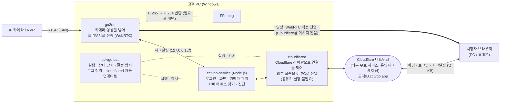

# CCTVGO

> 지금 설치된 CCTV를, 공유기 설정 없이, 밖에서 웹브라우저로 본다.

- 판매 페이지: https://cctvgo.app
- 개발: 김장현 (1인 개발: 기획, 설계, 구현, 시험, 패키징, 판매 페이지까지)
- 형태: Windows 설치형 소프트웨어

---

## 1. 무엇을 해결하는가

가게나 사무실에 있는 CCTV를 집에서 보려면 보통 공유기 포트포워딩, 고정 IP, DDNS 같은 작업이 필요합니다. 처음에 설치 기사가 설정해 줬더라도 통신사를 바꾸거나 공유기를 교체하고, 카메라 IP가 바뀌면 어느 날 갑자기 밖에서 안 보이게 됩니다. 고객은 대부분 네트워크를 모릅니다.

CCTVGO는 카메라와 같은 네트워크에 있는 Windows PC에서 실행됩니다. 실행하면 고객마다 정해진 주소(`고객ID.cctvgo.app`)가 생기고, PC나 휴대폰 브라우저로 그 주소에 접속하면 바로 영상을 볼 수 있습니다. 전용 앱은 필요 없습니다.

포트포워딩이나 DDNS 같은 공유기 설정은 하지 않아도 됩니다. 카메라 주소(RTSP)도 고객이 알 필요가 없습니다. 카메라 아이디와 비밀번호만 넣으면 CCTVGO가 자동으로 찾습니다. 고객이 하는 일은 프로그램 실행과 카메라 계정 입력이 전부입니다.

## 2. 설계 원칙

모든 설계 판단은 아래 세 원칙을 기준으로 했습니다. 기능이 동작하더라도 원칙을 어기면 실패로 봤습니다.

| 원칙 | 뜻 | 실패로 보는 것 |
|---|---|---|
| **고객에게 설정을 요구하지 않는다** | 고객이 할 일은 실행과 카메라 계정 입력뿐입니다. 자동으로 안 되는 경우에도 버튼 한 번으로 끝나야 합니다. | 공유기, 방화벽, 카메라 설정을 안내하는 것 |
| **잘 나오던 영상은 절대 끊지 않는다** | 카메라 추가·수정·삭제·배치 변경·주소 찾기가 다른 카메라 영상에 영향을 주지 않습니다. | 기존 카메라 영상에 영향을 주는 것 |
| **운영비는 도메인비 하나** | 운영자의 중앙 서버가 없습니다. 서버 기능은 모두 고객 PC에서 돌고, 영상 중계 서버(TURN)나 그 밖의 유료 서비스도 쓰지 않습니다. 고객이 늘어도 운영비가 늘지 않습니다. | 고객 수에 비례하는 비용이 생기는 구성 |

## 3. 구조



- 굵은 선: 영상 / 실선: 제어 / 점선: 실행·감시, 필요할 때만 쓰는 기능

- **중앙 서버 없이, 고객 PC가 곧 서버입니다.** 로그인, 화면 제공, 카메라 관리, 영상 전송까지 서버 기능은 모두 고객 PC에서 돕니다. 운영자가 관리하는 것은 도메인과 Cloudflare 무료 계정뿐입니다. 그래서 고객이 늘어도 서버 비용이나 서버 관리 부담이 늘지 않고, 고객 영상이 운영자 쪽에 모이지도 않습니다. 1인 개발자이자 회사원이라 서버를 계속 돌보기 어렵다는 제약에서 나온 구조입니다.
- **Cloudflare Tunnel로 공유기 설정 없이 외부 접속을 엽니다.** Cloudflare는 전 세계에 네트워크를 둔 인터넷 인프라 회사입니다. Tunnel은 Cloudflare가 무료로 제공하는 서비스로, 고객 PC의 cloudflared가 Cloudflare 쪽으로 먼저 연결을 맺어 둡니다. 시청자가 `고객ID.cctvgo.app`에 접속하면 Cloudflare가 그 연결을 통해 요청을 고객 PC로 전달합니다. 고객 PC가 바깥으로 연결을 맺는 방식이라 공유기 포트포워딩이나 고정 IP가 필요 없고, HTTPS 인증서도 Cloudflare가 처리합니다.
- **영상과 제어의 경로를 나눴습니다.** 영상은 WebRTC(UDP)로 고객 PC에서 시청자에게 바로 갑니다. Cloudflare Tunnel은 화면, 로그인, 연결 정보 교환(시그널링)처럼 트래픽이 적은 것만 맡습니다. 그래서 운영자의 Cloudflare 무료 계정 하나로 모든 고객을 받을 수 있고, 영상 트래픽에 대한 약관 문제를 피할 수 있습니다.
- **시그널링을 모듈로 분리해 Cloudflare를 교체할 수 있게 했습니다.** WebRTC 영상 연결 전에 브라우저와 고객 PC는 시그널링(서로의 접속 주소와 코덱 정보 교환)을 하고, 지금은 이 시그널링이 Cloudflare Tunnel을 거칩니다. 시그널링 코드는 백엔드 `backend/streams/live-routes.js`와 프론트엔드 `frontend/src/webrtc.js` 두 모듈에만 있습니다. Cloudflare 정책이 바뀌거나 다른 경로로 옮겨야 할 때 두 모듈만 교체하면 되고, 영상 전송, 카메라 관리, 화면 같은 나머지 코드는 고치지 않아도 됩니다.
- **NAT 통과는 무료 공용 STUN만 씁니다.** 고객 PC는 공유기 뒤의 사설 IP를 쓰기 때문에(NAT) 밖에서 바로 찾아올 수 없습니다. 그래서 STUN 서버로 공유기의 바깥 주소를 알아내고, 양쪽이 동시에 패킷을 보내 공유기를 통과합니다. 통과하지 못할 때 대신 영상을 실어 나르는 중계 서버(TURN)는 비용 원칙 때문에 쓰지 않습니다. 직접 연결이 안 되는 네트워크(일부 회사망, 이중 공유기 등)에서는 원인을 화면에 안내하고 기록합니다. 모든 환경을 지원하지 못한다는 점은 비용 원칙 때문에 받아들인 한계입니다.
## 4. 주요 설계 판단

### 4.1 미디어 서버: go2rtc
- **H.265 → H.264 변환을 FFmpeg 연동으로 기본 지원합니다.** 메인과 서브 스트림이 모두 H.265인 카메라는 이 기능이 없으면 PC 크롬·엣지에서 볼 수 없습니다.
- **시청자가 있을 때만 카메라에 접속합니다.** 아무도 보지 않을 때는 카메라와 고객 PC에 부하를 주지 않습니다.
- **실행 중에 API로 스트림을 추가·삭제할 수 있습니다.** 카메라를 바꿀 때 다른 카메라 영상을 건드리지 않아도 됩니다(4.6).
- **카메라가 재부팅돼도 브라우저와의 연결을 유지합니다.** 카메라가 돌아오면 같은 연결로 영상을 다시 보냅니다.
- **실행 파일 하나, MIT 라이선스입니다.** 설치형 상용 제품에 함께 배포하기 쉽습니다.
- 대안인 MediaMTX는 녹화가 내장돼 있지만 파일 저장까지만 합니다. 재생 화면과 전송 경로는 어차피 따로 만들어야 해서 결정적인 장점이 아니었습니다.

### 4.2 H.265 변환: GPL 인코더 없이, 고객 PC에서 동작하는 인코더를 자동 선택
- **libx264(GPL)를 넣지 않습니다.** 넣으면 배포하는 FFmpeg 전체가 GPL이 되기 때문입니다.
- **인코더를 고정하지 않고, 서비스 시작 시 실제로 동작하는 것을 고릅니다.** 하드웨어 인코더(Intel QSV, NVIDIA NVENC, AMD AMF)를 먼저 시험하고, 모두 안 되면 Windows 내장 인코더(Media Foundation)를 씁니다. 고객 PC 사양은 알 수 없고, 오래된 그래픽 드라이버에서는 하드웨어 인코더가 실패할 수 있기 때문입니다.
- **변환은 꼭 필요할 때만 합니다.** H.264 서브 스트림이 없을 때만 변환하고, 시청자가 여러 명이어도 카메라당 변환은 하나입니다. 고객 PC 부하를 줄이기 위해서입니다.

### 4.3 시청 기기에 맞춰 스트림을 고른다
CCTVGO 프론트엔드가 접속한 브라우저의 H.265 재생 가능 여부를 확인해 백엔드에 알리고, 백엔드가 아래 순서로 스트림을 고릅니다.
1. **원본(메인 스트림):** H.265를 재생할 수 있는 브라우저(아이폰 등)는 원본을 그대로 받습니다. H.264 카메라도 여기서 끝납니다.
2. **H.264 서브 스트림:** H.265를 재생할 수 없는 브라우저(PC 크롬 등)는 서브 스트림을 받습니다.
3. **변환본:** 서브 스트림도 H.265뿐이면 H.264로 변환한 스트림을 받습니다.

- 근거: 변환은 고객 PC에 부담이 크므로 꼭 필요한 기기에만 합니다. 성공한 단계는 기억해 두었다가 다음 연결에서 바로 씁니다.
- 원본, 서브, 변환본은 go2rtc에서 **서로 다른 스트림 이름**으로 둡니다. 한 이름으로 묶으면 go2rtc가 원본의 소리만 잡고 변환을 시작하지 않기 때문입니다.

### 4.4 UPnP는 아직 넣지 않는다
- **UPnP(공유기 포트 자동 열기)는 아직 넣지 않았습니다.** UPnP는 STUN 홀 펀칭이 실패하는 일부 네트워크(시청자 쪽 대칭형 NAT 등)를 구제할 수 있지만, 고객 쪽이 이중 공유기나 CGNAT이면 효과가 없고 공유기마다 동작이 달라 새로운 장애 원인이 될 수 있습니다.

### 4.5 카메라 주소(RTSP) 자동 찾기
고객은 카메라의 RTSP 주소를 모르므로, 카메라 계정만 넣으면 주소를 찾아 줍니다.
- **2단계로 찾습니다.**
  1. **ONVIF 조회:** ONVIF를 지원하는 카메라에는 RTSP 주소를 직접 물어봅니다.
  2. **RTSP 경로 후보 테이블:** ONVIF 조회가 실패하면, 제조사별로 정리한 RTSP 경로 후보 85개를 순서대로 시험합니다. ONVIF를 지원하지 않거나 꺼 둔 구형 카메라도 찾을 수 있습니다.
- **후보 테이블은 설치 폴더의 `rtsp-paths.json`으로 보강할 수 있습니다.** 설치형이라 판매 후 코드를 업데이트하기 어렵기 때문입니다.
- **ffprobe 대신 RTSP 확인을 소켓으로 직접 구현했습니다.** ffprobe는 후보마다 프로세스를 띄워 몇 초씩 걸리고, 실패하면 원인을 구분하기 어렵습니다. 직접 구현하면 후보 하나를 0.1~0.3초에 확인하고, RTSP 응답 코드로 실패 원인(인증 실패, 경로 없음, 연결 불가)을 정확히 나눌 수 있습니다.
- **"실제로 재생할 수 있는가"를 기준으로 판정합니다.** 카메라마다 RTSP 구현이 달라서 다음 두 경우를 흡수합니다.
  - 일부 카메라는 로그인용 일회용 값(nonce)을 그 연결에서만 인정해서, 다른 연결로 로그인하면 비밀번호가 맞아도 실패합니다. 그래서 로그인 과정을 하나의 TCP 연결 안에서 끝냅니다.
  - 계정만 맞으면 어떤 경로에나 성공(DESCRIBE 200)을 주는 카메라가 있어, SETUP까지 성공해야 주소로 인정합니다.
- **카메라 잠금을 막습니다.** 일부 카메라는 로그인 실패가 쌓이면 접속한 PC의 IP를 잠가 같은 PC의 영상까지 끊깁니다. 그래서 한 번 찾을 때 로그인 실패는 최대 2회로 제한하고, 실패로 셀 수 있는 TEARDOWN도 보내지 않습니다.
- **H.265 메인 스트림이면 서브 스트림도 찾아 함께 저장합니다.** 4.3의 대체 스트림으로 씁니다.

### 4.6 카메라를 바꿔도 다른 영상은 그대로
- **카메라를 바꿔도 영상 서버를 재시작하지 않습니다.** 설정 파일을 고치고 go2rtc를 다시 켜면 모든 영상이 끊기므로, 실행 중인 go2rtc에 API로 바뀐 카메라의 스트림만 추가·삭제합니다.
- **화면 배치를 바꿔도 영상을 다시 연결하지 않습니다.** 영상 요소는 그대로 두고 그리드 위치만 바꿉니다.

### 4.7 고객 설정 제로를 위한 장치들
- **고객 ID가 곧 접속 주소입니다**(`고객ID.cctvgo.app`). 패키지 생성 스크립트가 Cloudflare 터널과 DNS를 자동으로 만들어, 고객은 주소를 설정할 필요가 없습니다.
- **방화벽 규칙은 첫 실행 때 UAC 확인 한 번으로 추가합니다.** 대상은 이 설치 폴더의 `go2rtc.exe` 하나입니다. 고객이 거절해도 프로그램은 정상 실행되고, 다시 묻지 않으며, 거절한 사실은 기록합니다.
- **PC 절전 방지, 오래된 로그 자동 정리(30일), cloudflared 자동 업데이트**를 넣었습니다. cloudflared 업데이트는 백업 → 업데이트 → 실행 확인 순서로 하고, 실패하면 원래 버전으로 되돌립니다. 판매 후 고객 PC를 직접 관리할 수 없기 때문입니다.

### 4.8 보안
- **패키지마다 무작위 비밀번호:** 헷갈리는 문자(0, o, 1, l, i)를 뺀 8자리 비밀번호를 만들어 고객에게 따로 전달합니다. 접속 주소는 짐작할 수 있으므로 비밀번호가 고객마다 달라야 합니다. 새로 바꾸는 비밀번호도 8자 이상이어야 합니다.
- **접속자별 로그인 제한:** 5번 틀리면 15분 동안 막습니다. 전체 공통 잠금은 두지 않았습니다. 그렇게 하면 다른 사람이 일부러 틀려서 주인까지 못 들어오게 만들 수 있기 때문입니다.
- **로그인 제한을 우회하지 못하게 합니다:** 접속자 IP는 Cloudflare가 붙여 주는 헤더(`CF-Connecting-IP`)로 알아내는데, 이 헤더는 누구나 꾸며 넣을 수 있습니다. 그래서 로컬 cloudflared(127.0.0.1)를 거쳐 온 요청의 헤더만 믿어, 가짜 IP로 5회 제한을 피하지 못하게 합니다.
- **영상 서버 관리 기능 차단:** go2rtc의 관리 기능은 스트림 추가나 명령 실행까지 가능해 외부에 열리면 위험합니다. 그래서 go2rtc는 같은 PC에서만 접근할 수 있게 하고, 외부에서는 로그인한 사용자의 영상 연결 요청만 백엔드를 거쳐 전달합니다. go2rtc의 관리 기능은 외부에 노출시키지 않습니다.
- **비밀번호 변경 시 모두 로그아웃:** 비밀번호를 바꾸면 다른 기기의 세션을 모두 끊습니다.
- **로그 보호:** 로그와 진단 파일에는 카메라 비밀번호를 남기지 않습니다.

### 4.9 장애를 스스로 알아채고 복구한다
- **영상 멈춤은 받은 데이터 양으로 판단합니다.** 카메라 전원이 꺼져도 브라우저와 go2rtc 사이의 연결은 살아 있고 영상만 멈추기 때문에, 연결 상태로는 알 수 없습니다. 받은 데이터가 10초 동안 늘지 않으면 멈춘 것으로 봅니다.
- **카메라가 2분 넘게 응답하지 않으면 그 칸에 조치 방법을 안내합니다.** 카메라 전원과 랜선을 확인하고, 그래도 안 되면 카메라를 삭제한 뒤 다시 등록하라고 알려 줍니다. 공유기가 카메라 IP를 바꾸는(DHCP) 경우가 흔하기 때문입니다.
- **사용자 조작 없이 다시 재생합니다.** 카메라 재연결, 연결 끊김, 영상 일시정지 모두 자동으로 복구합니다.
- **영상 서버 감시와 자동 재실행(watchdog):** cctvgo-service가 go2rtc를 감시하다가 비정상 종료되면 자동으로 다시 실행합니다. 계속 실패하면 재시도 간격을 두 배씩 늘려 PC에 부담을 주지 않습니다. `cctvgo.bat`은 각 프로세스 상태와 CPU, 메모리, 디스크, 네트워크 사용량을 화면에 보여 주고 날짜별 로그로 남깁니다.
- **실패를 원인까지 기록합니다.** 로그를 서버로 모으지 않으므로(비용 원칙), 고객 PC에 연결 실패 단계와 네트워크 환경(방화벽, 이중 공유기·CGNAT 여부 등)을 기록합니다. 고객은 문의할 때 설정 화면의 **진단 파일 받기**로 묶어 보냅니다. 비밀번호는 기록하지 않습니다.

## 5. 검증

- **자동 테스트:** `node:test`로 백엔드와 프론트엔드 로직을 테스트합니다. 더미 RTSP·ONVIF 서버를 만들어 놓고 인증 흐름, 경로 탐색, 실패 횟수 제한을 실제 소켓으로 시험합니다.
- **실기 시험:** H.264 카메라와 H.265 카메라(메인과 서브가 모두 H.265)로 시험했습니다. 시청 환경은 PC 크롬·엣지, 아이폰, 안드로이드 휴대폰과 태블릿이고, 네트워크는 같은 LAN, 외부 와이파이, LTE입니다.
- **장시간 실행:** 11시간 연속 재생에서 끊김이 없었고, 변환이 다시 시작된 적도 없었으며, 메모리도 늘지 않았습니다.
## 6. 기술 스택

| 영역 | 사용 기술 |
|---|---|
| 백엔드 | Node.js, Express (`pkg`로 단일 exe 빌드) |
| 프론트엔드 | Vue 3 |
| 영상 | go2rtc, FFmpeg |
| 프로토콜 | WebRTC, STUN, RTSP, ONVIF |
| 외부 접속 | Cloudflare Tunnel (cloudflared) |
| 실행·배포 | Windows Batch 스크립트 |
| 테스트 | `node:test` (더미 RTSP·ONVIF 서버) |

## 7. 폴더 구성

```
backend/
  server.js          서버 시작, 로그인, 라우트 등록
  streams/           go2rtc 실행·감시, 스트림 관리, 인코더 선택, 시그널링
  finder/            카메라 주소 찾기, 카메라 관리(추가·수정·삭제, cctv.txt 저장), 화면 배치 저장
  settings/          비밀번호 저장, 로그인 제한
  diagnostics/       환경 점검, STUN, 진단 파일 묶기
  tests/             자동 테스트 (더미 RTSP·ONVIF 서버 포함)
frontend/
  src/               화면 (영상, 카메라 관리·찾기, 설정, 로그인), WebRTC 연결, 멈춤 감지
  tests/             자동 테스트
go2rtc/              영상 서버 (함께 배포)
ffmpeg/              H.265 → H.264 변환 (함께 배포)
cloudflare/          cloudflared (함께 배포)
utils/               방화벽 규칙, 절전 방지, cloudflared 업데이트 스크립트
customer/            고객 패키지에 넣는 안내 문서
site/                판매 페이지 (cctvgo.app)
docs/                설계서, 구현 계획, 시험 기록, 사업 문서
oss-sources/         동봉한 오픈소스의 소스 보관 (라이선스 의무)
cctvgo.bat           고객 PC 실행기
make_package.bat     고객 패키지 생성
make_package_login.ps1  고객별 비밀번호와 사용 방법.txt 생성
```

## 8. 개발·빌드·실행

### 개발 실행
```bash
cd backend
generate-env.bat     # 처음 한 번: 세션 키(.env) 생성
npm install
npm run start:all    # 프론트엔드 빌드 후 서버 시작 → http://localhost:8085

# 테스트
npm test                          # 백엔드 (backend 폴더에서)
node --test "frontend/tests/*.test.js"   # 프론트엔드 (저장소 루트에서)
```
개발 환경에서는 저장소 루트의 `go2rtc/`, `ffmpeg/`를 그대로 사용하고, 로그인 비밀번호는 `backend/config.json`에 있습니다.
개발 실행은 백엔드와 go2rtc까지만 띄웁니다. cloudflared(외부 접속)와 `cctvgo.bat`의 기능(절전 방지, 방화벽 규칙 등)은 패키지로 실행할 때만 동작합니다.

### 고객 패키지 만들기
```
make_package.bat
```
고객 ID를 입력하면 아래 작업을 순서대로 하고 `package/` 폴더를 만듭니다.
1. 고객마다 새 세션 키(`.env`)를 만듭니다.
2. Cloudflare 터널과 DNS(`고객ID.cctvgo.app`)를 만듭니다.
3. 고객별 무작위 비밀번호를 만듭니다.
4. 프론트엔드를 빌드합니다.
5. 백엔드를 exe로 빌드합니다(`pkg`).
6. go2rtc, FFmpeg, cloudflared, 실행 스크립트, 안내 문서를 복사합니다.

패키지를 만드는 운영자 PC에 필요한 것: Node.js, `pkg`(전역 설치), 운영자 Cloudflare 계정 로그인(cloudflared).

고객 PC에는 따로 설치할 것이 없습니다. Node.js는 `cctvgo-service.exe` 안에, go2rtc·FFmpeg·cloudflared는 패키지 안에 들어 있습니다. 고객은 `package` 폴더를 받아 `cctvgo.bat`을 실행하고, 안내받은 주소와 비밀번호로 접속합니다.

## 9. 오픈소스

| 구성 요소 | 라이선스 | 사용 방식 |
|---|---|---|
| [go2rtc](https://github.com/AlexxIT/go2rtc) | MIT | 별도 실행 파일 |
| [FFmpeg](https://ffmpeg.org) | LGPL v3 (libx264 등 GPL 구성 요소를 넣지 않은 빌드) | 별도 실행 파일, 명령줄로 호출 |
| [cloudflared](https://github.com/cloudflare/cloudflared) | Apache 2.0 | 별도 실행 파일 |

- 모든 외부 구성 요소는 별도 프로세스로 실행하며, CCTVGO 코드와 정적·동적으로 링크하지 않습니다. 그래서 LGPL·MIT·Apache 조건은 CCTVGO 코드에 적용되지 않고, 함께 배포하는 실행 파일에만 적용됩니다.
- FFmpeg는 고지문에 정확한 버전을 적고 "요청 시 소스 제공" 문구를 넣었습니다(LGPL v3의 소스 제공 의무). 판매 조건의 역분석 금지 조항은 오픈소스 구성 요소에는 적용되지 않는다고 명시했습니다.
- 고객에게 전달하는 고지문은 `customer/라이선스 및 고지.txt`에 있습니다.

## 10. 저작권

© 김장현. All rights reserved. 이 저장소의 코드는 공개 라이선스로 배포하지 않습니다.
